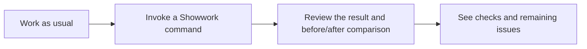
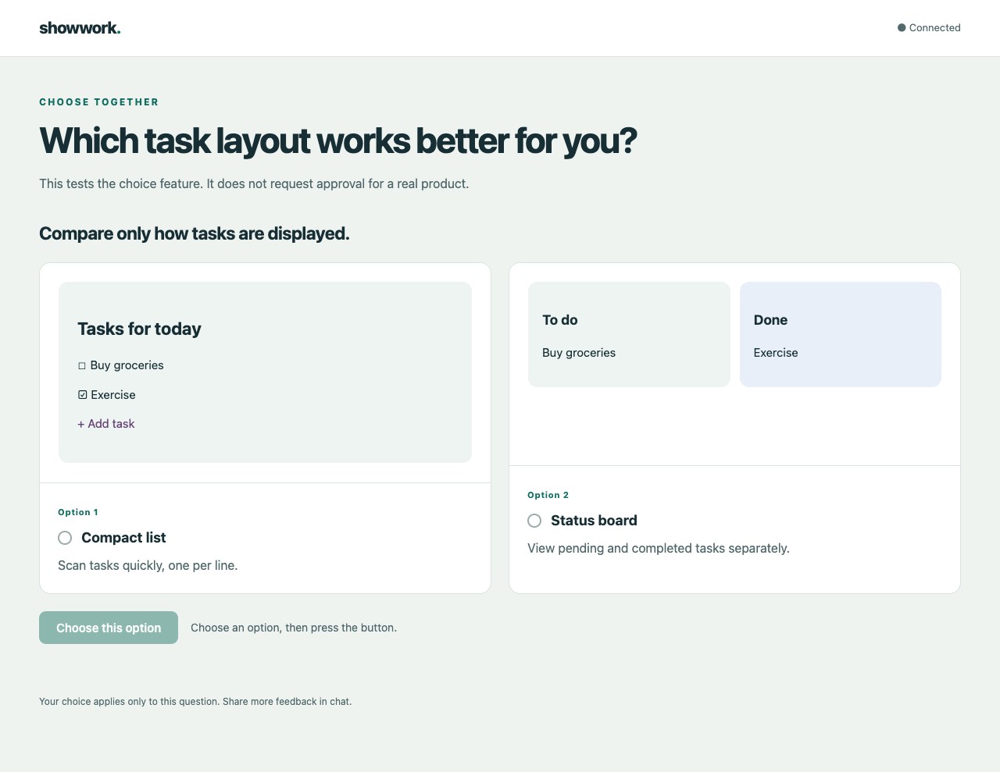

# Showwork

**See what changed after the work is done.**

Showwork stays off during ordinary work. Invoke a command when you want to see changed screens and behavior, completed checks, and remaining issues in a browser.



## Install and update

```bash
npx --yes github:cwsbrian/showwork
```

This installs Showwork for both Codex and Claude Code at the user level. Run the same command again to update to the latest version. Requires Node.js 20 or newer, Git, and Python 3.11 or newer. No separate API key is needed.

Open a **new session** after installation. Ordinary work requests do not activate Showwork.

## Use after finishing work

| Installation | Result walkthrough command |
| --- | --- |
| Codex user installation | `$showwork Show me the work you just finished` |
| Claude user installation | `/showwork Show me the work you just finished` |
| Claude plugin | `/showwork:run Show me the work you just finished` |

A bare command also inspects the current task and changes. If the target is unclear, it asks only what result to show. A request for a result walkthrough does not trigger new implementation or code changes. If the command explicitly requests new implementation too, finish the implementation and checks before showing the result.

The explanation focuses on:

- What changed and how it improved on the previous behavior
- How the screen and feature behave now
- Which changed files are worth reviewing and why each matters
- What was actually checked and what remains unresolved

Reports open in the optional macOS Showwork app (see [App (macOS)](docs/installation.md#app-macos)); without it, a localhost browser page is used.

It avoids a long work diary or approval at every step. Put supporting technical detail under “Show details.”

## Other commands

| Purpose | Codex | Claude user installation | Claude plugin |
| --- | --- | --- | --- |
| Plan only | `$showwork-plan` | `/showwork-plan` | `/showwork:plan` |
| Review changes | `$showwork-review` | `/showwork-review` | `/showwork:review` |
| Verify behavior | `$showwork-verify` | `/showwork-verify` | `/showwork:verify` |
| Adversarial review with visual report | `$showwork-adverial-review` | `/showwork-adverial-review` | `/showwork:adverial-review` |
| Set Obsidian vault and project folders | `$showwork-set-location` | `/showwork-set-location` | `/showwork:set-location` |
| Save agreed decisions and current architecture | `$showwork-save` | `/showwork-save` | `/showwork:save` |

Each command runs only when invoked directly. Ordinary requests and discussion about Showwork are not invocations. Activation for one task does not carry over to a different task.

## Installation locations and older versions

| Tool | Skills | Command-only instructions |
| --- | --- | --- |
| Codex | `~/.agents/skills/showwork*` | `~/.codex/AGENTS.md` (active override takes precedence) |
| Claude Code | `~/.claude/skills/showwork*` | `~/.claude/CLAUDE.md` |

The installer respects `CODEX_HOME` and `CLAUDE_CONFIG_DIR`. It replaces older automatic instructions within the managed block with command-only instructions. It preserves user instructions outside that block and other skills. Codex implicit invocation and Claude model invocation are disabled, and the plugin's per-request automatic hook has been removed.

If you previously installed Showwork in a project, update that project with `npx --yes github:cwsbrian/showwork --target /absolute/project`. Old installations in other projects are not found or changed automatically. Avoid activating both the user-installed skill and the plugin copy of the same skill.

Add `--runtime codex` or `--runtime claude` to install for only one tool. The package is not published to the npm registry, so use the GitHub command above rather than `npx showwork`. See the [installation and recovery guide](docs/installation.md).

To use the Claude plugin directly, clone the repository and run:

```bash
claude --plugin-dir /absolute/path/to/showwork
```

You can also use the Python installer directly. Update the source repository first.

```bash
python3 /absolute/path/to/showwork/scripts/install_codex.py --user
```

## Visual adversarial review

The command retains the requested spelling `adverial-review`. Invoke it according to your installation.

| Installation | Example |
| --- | --- |
| npx user installation · Claude Code | `/showwork-adverial-review Review my current changes` |
| npx user installation · Codex | `$showwork-adverial-review Review my current changes` |
| Claude plugin | `/showwork:adverial-review Review my current changes` |

The review reads the changed scope and actual call paths, then examines code-specific counterexamples involving permissions, boundaries, duplicate actions, and partial failures. It presents severity, source location, reproduction conditions, expected and actual behavior, and evidence in a Showwork report (the app, or the browser fallback). Fixes are applied only when separately requested.

For mobile apps, launch the target iOS Simulator or Android Emulator, then **install the review build → launch the app → interact with relevant screens → attach real screenshots**. Record the device, OS, build, interactions, and capture source. If the simulator, SDK, build setup, or control tool is unavailable, mark those steps unverified and continue the code review where possible. A mobile web viewport or mockup does not replace a native app capture.

## Review together in the browser



- **Choice screen:** Compare rendered UI or diagrams side by side. Record a choice by click or keyboard. If the screen changes, an earlier choice does not apply to the new question.
- **Result screen:** Explain changes with full-width visuals and a table of contents. Show a short, visible list of important changed files and why each matters. For router changes, lead with a connected flowchart of branches and responses. For database changes, lead with a before/after ERD showing PK/FK fields and relationship counts. Put route tables, schema comparisons, and migration/backfill/rollback details in supporting material. Include component and data-flow diagrams for structural changes. Cover only areas changed in the task.
- **Evidence:** Show source locations, reasons for changes, actual check results, and unverified points. Distinguish explanatory diagrams from observations, and authored migrations from executed ones. There is no approval button.

Keep the explanation short and simple enough for a third-grade reader, while speaking respectfully to adults. Show what changed and why it helps first. Explain unfamiliar terms immediately and place code and commands under **Show details**. Keep important problems and unchecked points visible.

By default, delegate only report writing to a Codex Luna or Claude Haiku subagent. The main model operates the app or simulator, captures screens, judges review findings, and inspects the final page. If model selection is unavailable, the main model writes the report and discloses the fallback. An explicit preference such as Terra or Sonnet takes precedence; do not change global model settings. This is an agent instruction, not server-enforced model routing. Click a capture to see it full-window; click it again (or **Actual size**) to see it pixel for pixel.

Reports are kept in the Showwork app folder (`~/Library/Application Support/Showwork` on macOS), never in the project, until you delete them from the app. Captures and check records go in a per-project temporary folder under **`/tmp`**, which the OS may clean; Windows uses its own temporary directory.

The browser tool lives inside the `showwork` skill and is copied with both user and project installations. It uses only the Python standard library and updates the page automatically. See the [browser guide](skills/showwork/references/companion.md) for usage and page format. Browser choices are recorded, but they do not automatically wake a waiting agent; continue in chat when needed.

Web captures can run in headless Chrome and appear as live tabs in the Showwork app; see [capture web pages in the app](skills/showwork/references/companion.md#capture-web-pages-in-the-app).

## Record verification evidence

An optional Python tool records existing test output, API results, and screenshots against criteria. It has no external dependencies.

```bash
python3 /absolute/path/to/showwork/scripts/showwork.py init cancellation \
  --title "Subscription cancellation" \
  --criterion "Keep access until period end and stop the next payment"
```

Record actual check commands with `check ... -- <command>` and attach files you inspected with `attach`. Results go under `/tmp`. Use the path printed by `init` in subsequent commands. The [evidence tool guide](docs/evidence.md) has examples.

A successful recorder run means **evidence was collected**. The agent must still judge whether that evidence meets the criteria and remains valid for the current code. The skills also work without this tool.

## v0.5 scope and verification

This version provides shared skills, user installation and updates for both runtimes, a plugin format, an evidence recorder, and browser explanations for each changed area. Every invocation method is command-only and does not interrupt ordinary requests. The companion displays visual material. Actual browser interaction, screenshot collection, and simulator verification use tools available in the environment; unsupported criteria are reported as unverified.

```bash
python3 -m unittest discover -s tests -v
npm test
claude plugin validate . --strict
```

The [validation record](docs/validation.md) describes what was actually checked and its limits. The [behavior example](examples/subscription-cancellation.md) shows the intended user experience.

```text
.codex-plugin/plugin.json    Codex manifest
.claude-plugin/plugin.json   Claude Code manifest
commands/                   Short Claude commands
instructions/manual.md      Shared command-only guidance for both environments
skills/                     Five shared skills for both environments
skills/showwork/scripts/     Local browser companion
skills/showwork/assets/      Choice and result screens
scripts/install_codex.py     User/project skill and instruction installer
scripts/cli.cjs              npx installer entry point
scripts/showwork.py          Optional evidence recorder
tests/                      Installer and evidence regression tests
```

### Live Android Emulator sessions (macOS)

Install Python 3.11+ and Android SDK Platform Tools (`adb`) on the Showwork host. Boot an emulator with your normal Android tools first; Showwork attaches only to an already booted emulator. Select its explicit `emulator-<digits>` serial from `adb devices -l` (for example `emulator-5554`), then start a Showwork task and attach:

```sh
python3 /absolute/skill/showwork/scripts/companion.py emulator open --project /absolute/project --serial emulator-5554 --title "Android preview"
python3 /absolute/skill/showwork/scripts/companion.py emulator close --project /absolute/project --session SESSION-ID
```

The Android tab is an image-only screen: tap or drag to swipe, with coordinates updated when the frame rotates. Split previews are view-only. Use agent-side `adb` for text, Home, and app setup. Showwork captures at most four PNG frames per second and keeps only the newest preview in memory. Closing an attachment, stopping, or publishing ends the relay and leaves the emulator running. Physical devices are not supported.

Capture report evidence separately with `adb -s SERIAL exec-out screencap -p > /tmp/android-evidence.png` or an existing Maestro flow. Inspect the image and record the emulator, Android version, app build, actions, and capture method; a streamed preview is not report evidence.
