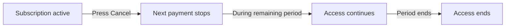

# Expected behavior: review finished work

This shows an explanation style, not the result of inspecting a real app.

First, make an ordinary request.

> Add subscription cancellation.

Showwork stays off. After the work is done, invoke it when you want to see the result.

> $showwork Show me the subscription cancellation feature you just made.

The report starts with the outcome.

> Canceling now stops the next payment. You can keep using the subscription until the current period ends.

If a real cancellation screen exists, show a capture and explain the behavior as below. Include only claims supported by the code and checked evidence.

List checks and remaining issues separately. For example, if you checked whether pressing Cancel twice is safe, explain the result. If you could not test the real payment integration, make that clear. Do not present a mock screen as evidence of a real payment flow.

Put file locations and check commands under “Show details.” Leave a short outcome and browser link in chat. A request to explain results does not call for rewriting code or asking for approval.
